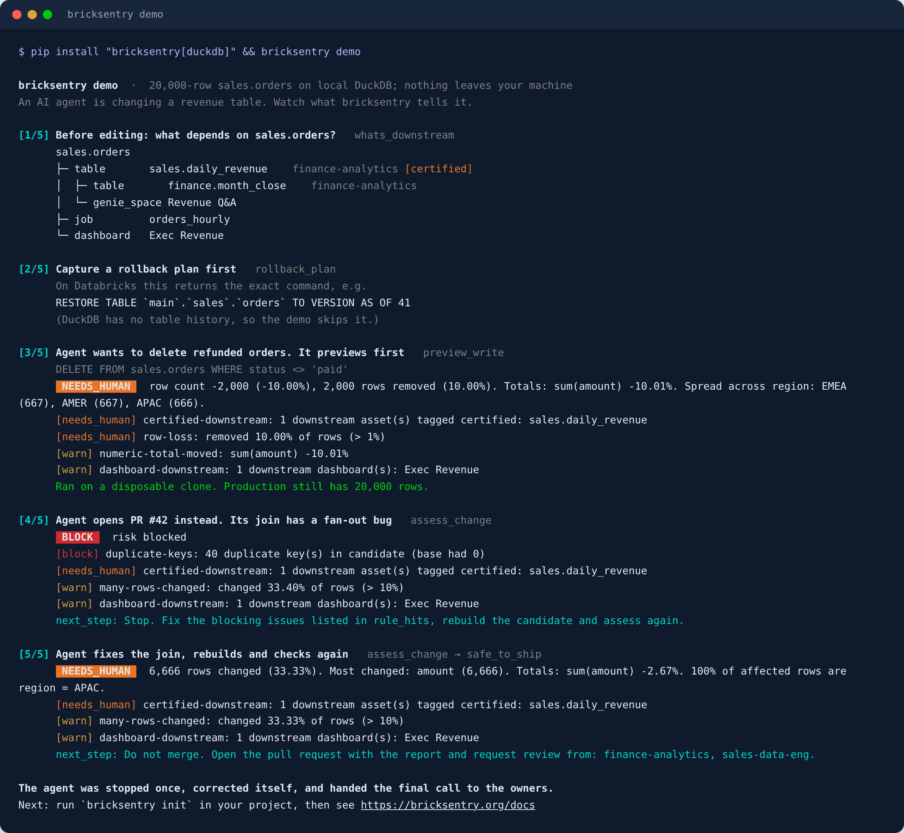
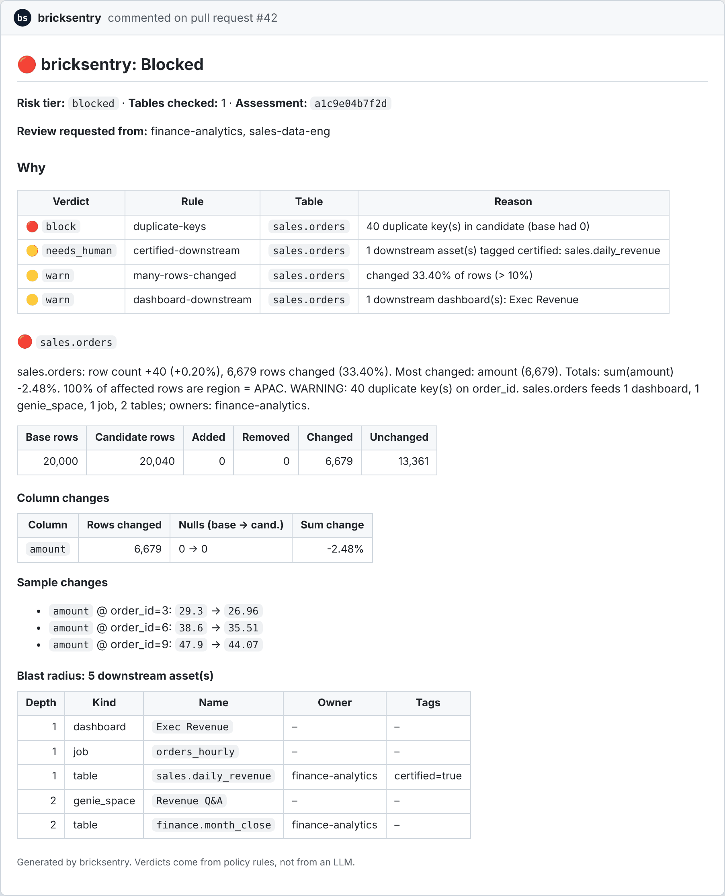

# Welcome to bricksentry

[](https://pypi.org/project/bricksentry/) [](https://pypi.org/project/bricksentry/) [](https://github.com/bricksentry/bricksentry/actions/workflows/ci.yml) [](https://github.com/bricksentry/bricksentry/actions/workflows/lint.yml) [](https://github.com/bricksentry/bricksentry/actions/workflows/ci.yml) [](LICENSE)

***The safety check for data changes in the AI era.***

Change-safety for Databricks pipelines and the AI agents that edit them: know what a change does to your data before it ships.

**[Try it in 30 seconds](#try-it-in-30-seconds-no-databricks-needed)** · **[Run the Databricks notebook](#run-it-in-your-databricks-workspace)** · **[Docs: bricksentry.org](https://bricksentry.org)**

Built by Brahmareddy, Databricks Champion. Open source under Apache-2.0.

*Why the name?* Bricks plus entry. Your tables and pipelines are the bricks of the lakehouse, and every change to them is an entry. bricksentry checks each entry, reports what it does, and stands guard before it lands.

## Try it in 30 seconds (no Databricks needed)

```bash
pip install "bricksentry[duckdb]"
bricksentry demo
```

An AI agent changes a 20,000-row revenue table. bricksentry previews its DELETE on a clone (production untouched), **blocks** its pull request for a join that duplicates 40 orders, and routes the fixed version to the owners of a certified table downstream. Everything runs locally on DuckDB.



## Run it in your Databricks workspace

> **Databricks quickstart notebook:** in your workspace, go to **Workspace → Import → URL** and paste
> `https://raw.githubusercontent.com/bricksentry/bricksentry/main/examples/databricks/bricksentry_quickstart.py`

The [quickstart notebook](examples/databricks/bricksentry_quickstart.py) creates a small demo table in a schema you choose and runs the same loop on Databricks: Unity Catalog blast radius, a real `RESTORE` rollback plan, a preview on a shallow clone, a blocked pull request and the fix. Then it checks one of your own tables, read-only, and cleans up after itself.

You need a SQL warehouse, `CREATE TABLE` on the schema you pick, and `SELECT` on `system.access.table_lineage` for the blast radius. A Jupyter copy is in [`bricksentry_quickstart.ipynb`](examples/databricks/bricksentry_quickstart.ipynb).

## What it does

Before a change reaches production, bricksentry answers three questions, in a
pull-request comment for humans and in structured JSON for agents:

1. **What does it do to the data?** A key-based data diff: added, removed and changed rows, schema changes, per-column changes, numeric totals, duplicate keys, and *where* the change is concentrated ("100% of affected rows are region = APAC").
2. **Who gets hurt?** The downstream blast radius from Unity Catalog lineage: tables, jobs, notebooks, Lakeflow pipelines, dashboards and queries, with owners and tags.
3. **Is it safe, and how do I undo it?** A deterministic policy verdict (`pass` · `warn` · `needs_human` · `block`) and the exact `RESTORE TABLE … VERSION AS OF n` rollback.

For your Databricks workspace:

```bash
pip install "bricksentry[databricks,mcp]"
bricksentry init        # writes bricksentry.yml and policy.yml
```

## Why it exists

AI now writes much of our pipeline code, and checking what that code does to the data hasn't kept up. Code review can't see a silent 3% revenue shift or a join that fans out. The tools that do catch this mostly cover dbt, or need a paid platform. Most Databricks work is PySpark notebooks, Jobs and Lakeflow pipelines, and bricksentry is built for that work:

- **Unity Catalog runtime lineage**, not SQL parsing, so PySpark notebooks and jobs are included.
- **SQL pushdown**: all diffing runs on your SQL warehouse, so no Spark session is needed and calls stay cheap enough for an agent loop.
- **One engine, three faces**: CLI and GitHub Action · Python API · MCP server.

## For AI agents: the MCP server

```bash
bricksentry mcp --config bricksentry.yml                 # stdio
claude mcp add bricksentry -- bricksentry mcp --config /abs/path/bricksentry.yml
```

| Tool | What the agent gets |
|---|---|
| `whats_downstream(table, depth)` | Downstream assets with owners and tags. Call it *before* editing. |
| `rollback_plan(table)` | The restore SQL. Capture it *before* changing anything. |
| `preview_write(sql, target, keys?)` | Runs one write against a **disposable shallow clone**, never production, and returns the diff plus verdict. |
| `assess_change(tables, candidates?, pr?)` | Diffs prod vs. the candidate built by your change, plus lineage and policy. Returns a verdict and an `id`. |
| `explain_diff(assessment_id or table)` | Plain-English summary. |
| `safe_to_ship(assessment_id)` | `safe_to_ship`, the reasons, and an explicit `next_step` to follow. |

Designed for agents:

- **The verdict never comes from an LLM.** Rules in `policy.yml` decide, so the same change always gets the same answer.
- **Read-only by default.** Only `preview_write` writes, and only to a sandbox clone. It accepts a single INSERT / MERGE / UPDATE / DELETE / CREATE OR REPLACE whose target must be the clone, and it refuses DROP, TRUNCATE, ALTER, GRANT and multiple statements.
- **Errors come back as `{"error": ...}`**, so agents can recover instead of crashing.
- **Bounded cost:** deterministic hash sampling (`sample_pct`), capped samples, and lineage limited by depth and lookback window.

The same tools are plain Python functions in `bricksentry.agent_tools`, so you can use them from LangGraph, the OpenAI Agents SDK or the Databricks Agent Framework without MCP.

To watch the whole loop, run `bricksentry demo` (see the top of this page). `bricksentry demo --report report.md` also writes the pull-request comment a reviewer would see.

## For data engineers: CLI and CI

```bash
bricksentry init                                        # starter bricksentry.yml + policy.yml
bricksentry impact main.sales.orders                    # blast radius
bricksentry diff main.sales.orders main.sales_pr_42.orders
bricksentry preview main.sales.orders --sql "MERGE INTO {{target}} t USING updates u ON t.order_id = u.order_id WHEN MATCHED THEN UPDATE SET *"
bricksentry assess --from-git origin/main --pr 42 --format markdown --fail-on needs_human
bricksentry rollback main.sales.orders
```

Exit codes: `0` below `--fail-on`, `1` at or above it, `2` for configuration errors.

**In GitHub Actions.** Build your PR's version of the pipeline into a per-PR schema (for example with a Databricks Asset Bundle `ci` target), then add:

```yaml
- run: pip install "bricksentry[databricks]"
- run: >
    bricksentry assess
    --from-git origin/${{ github.base_ref }}
    --pr ${{ github.event.pull_request.number }}
    --comment --output bricksentry-report.md
    --fail-on needs_human
  env:
    GITHUB_TOKEN: ${{ github.token }}
    DATABRICKS_HOST: ${{ secrets.DATABRICKS_HOST }}
    DATABRICKS_CLIENT_ID: ${{ secrets.DATABRICKS_CLIENT_ID }}
    DATABRICKS_CLIENT_SECRET: ${{ secrets.DATABRICKS_CLIENT_SECRET }}
    DATABRICKS_WAREHOUSE_ID: ${{ secrets.DATABRICKS_WAREHOUSE_ID }}
```

It detects changed tables from the files in the PR and posts or updates one PR comment, like this one for the demo's fan-out bug:



Check out with `fetch-depth: 0` and give the job `pull-requests: write` permission.

Or use the bundled GitHub Action, which also writes the report to the job summary:

```yaml
- uses: bricksentry/bricksentry@v0.1.0
  with:
    config: bricksentry.yml
    fail-on: needs_human
```

## Python API

```python
from bricksentry import Sentry

s = Sentry()                                   # reads ./bricksentry.yml
a = s.assess(["main.sales.orders"], pr="42")
print(a.verdict, a.notify)
print(a.tables[0].summary)

s.preview_write("DELETE FROM main.sales.orders WHERE status = 'test'", "main.sales.orders")
```

## Configuration

```yaml
backend: {type: databricks, warehouse_id: abc123}      # auth: standard Databricks SDK chain
sandbox_schema: main.bricksentry_sandbox
candidate_pattern: "{catalog}.{schema}_pr_{pr}.{table}"
sample_pct: 10
lineage: {type: databricks, depth: 3, lookback_days: 90}   # also: exclude, exclude_dropped
tables:
  main.sales.orders:
    keys: [order_id]
    segment_by: [region]
    paths: ["src/pipelines/orders/**", "resources/orders_job.yml"]
policy: policy.yml
```

### Policy example

A small `policy.yml` with one rule per severity. `pass` is the default: a change gets it when no rule matches.

```yaml
default: pass                       # no rule matched -> pass
notify_owners_on: needs_human       # tag downstream owners from this level up

rules:
  - name: type-change               # a column changed type -> warn
    when: {column_type_changed: true}
    then: warn

  - name: revenue-moved             # total revenue moved more than 2% -> a human signs off
    when: {column: amount, sum_change_pct_gt: 2}
    then: needs_human

  - name: duplicate-keys            # a join fanned out and duplicated keys -> block the PR
    when: {duplicate_keys: true}
    then: block
```

| The change | Verdict |
|---|---|
| A filter fix that changes 40 rows, nothing else | `pass` |
| `order_date` goes from `STRING` to `DATE` | `warn` |
| A pricing fix moves `SUM(amount)` by 3.1% | `needs_human` |
| A new join duplicates 40 `order_id`s | `block` |

If several rules match, the most severe one wins. The full starter policy is in [`examples/databricks/policy.yml`](examples/databricks/policy.yml), and `bricksentry init` writes one for you.

### Policy conditions

`table` (glob) · `tag` · `downstream_tag` · `downstream_kind` · `downstream_count_gt` · `removed_pct_gt` · `added_pct_gt` · `changed_pct_gt` · `row_count_change_pct_gt` · `row_count_drop_pct_gt` · `column_removed` · `column_added` · `column_type_changed` · `duplicate_keys` · `null_keys` · `sum_change_pct_gt` / `null_increase_gt` (optionally with `column`) · `any_change` · `diff_error`

All conditions in a `when` must hold. The most severe matching rule sets the verdict. Unknown conditions are rejected at load time, so a typo can't silently disable a rule.

## Permissions needed on Databricks

- `CAN USE` on a SQL warehouse.
- `SELECT` on the tables you assess and their candidates.
- `SELECT` on `system.access.table_lineage`, plus `system.information_schema` for owners and tags. Without these, bricksentry still diffs; lineage is just empty.
- `CREATE TABLE` on `sandbox_schema`, for `preview_write`.

## Known limits (v0.1.x)

- **Lineage is recorded at runtime.** Brand-new tables have no downstream history yet. Unity Catalog doesn't capture RDD operations, and UDFs hide column-level mapping.
- **Keys are required.** Tables without a stable key can't be diffed row by row yet (an aggregate-profile mode is planned).
- **Changed-table detection uses path globs** from config. It doesn't parse Asset Bundles yet.
- **Validated on one Databricks workspace so far** (serverless, November 2026): lineage, Delta rollback plans, previews on shallow clones, every verdict level and sampling. The automated tests use DuckDB and a mocked SDK, so please [open an issue](https://github.com/bricksentry/bricksentry/issues) if something behaves differently on yours.

## Roadmap

**Top priority: validation across more workspaces.** Classic and serverless compute, AWS, Azure and GCP, and workspaces with restricted system-table access. If you run the quickstart notebook, please [share what you see](https://github.com/bricksentry/bricksentry/issues), whether it works or not.

Next: Asset Bundle parsing for automatic table detection · column-level blast radius from `system.access.column_lineage` · an aggregate diff for keyless tables · Lakeflow expectations in the verdict · `bricksentry watch` for scheduled drift checks · a Databricks App UI.

## Contributing

Bug reports from real pipelines help the most. See [CONTRIBUTING.md](CONTRIBUTING.md), and [SECURITY.md](SECURITY.md) for reporting vulnerabilities privately.

## License

Apache-2.0. Created and maintained by Brahma - Databricks Champion.

## Trademarks

bricksentry is an independent open-source project. It is not affiliated with, endorsed by, or sponsored by Databricks, Inc. or Functional Software, Inc. (Sentry). Databricks, Unity Catalog and Lakeflow are trademarks of Databricks, Inc. Delta Lake is a trademark of the Linux Foundation, and Apache Spark and PySpark are trademarks of the Apache Software Foundation. All other names are the trademarks of their respective owners and are used here only to describe compatibility. Thank you.
